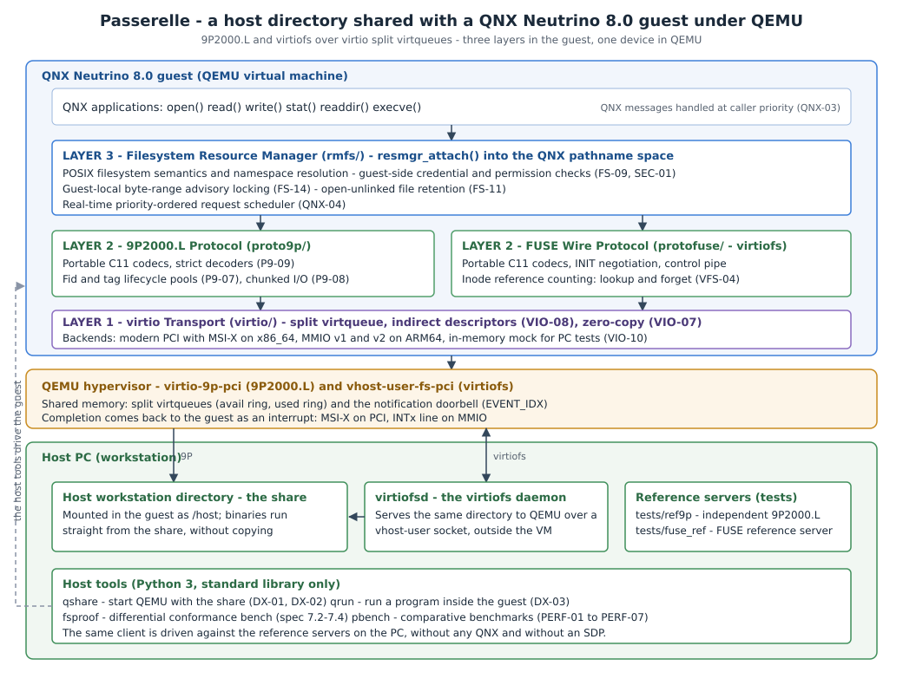

# Passerelle — Detailed Architecture & Technical Design

This document details the internal design of **Passerelle**, a high-performance host-guest shared filesystem driver for **QNX® Neutrino® 8.0** under QEMU. It covers the three-layer architectural model, the lifecycle of an I/O request, the resolution of delicate kernel and protocol challenges, and the source file mapping across the repository.



**Reading the picture.** The one thing to keep in mind is that the guest and the host never talk to each other directly: they talk through layers. Inside the QNX guest, an application's `read()` becomes an IPC message handled by the resource manager (`rmfs/`), which speaks one of the two wire protocols (`proto9p/` for 9P2000.L, `protofuse/` for virtiofs); both hand raw buffers to the virtio transport (`virtio/`), which is the only layer that knows about PCI, MMIO, MSI-X and virtqueues. QEMU is a single band underneath — `virtio-9p-pci` or `vhost-user-fs-pci` — and the host side is a single directory, served either by QEMU itself or by `virtiofsd`. Everything drawn to the side of the guest — `qshare`, `qrun`, `fsproof`, `pbench`, and the reference servers of `tests/ref9p` and `tests/fuse_ref` — is host tooling that drives the *same* client, which is why the stack can be exercised on the PC with no QNX and no SDP. The ASCII diagram in §1 is the same picture in text.

---

## 1. Architectural Overview: Three Layers

Passerelle decouples the guest operating system interface, the wire protocol, and the underlying hypervisor transport into three strict layers:

```
  QNX Applications: open(), read(), write(), stat(), readdir(), execve()...
        │  QNX Neutrino IPC Messages handled at caller priority (QNX-03)
 ┌──────▼────────────────────────────────────────────────────────┐
 │ LAYER 3 — Filesystem Resource Manager (`rmfs/`)               │
 │   - POSIX filesystem semantics & namespace resolution         │
 │   - Guest-side credential & permission checks (FS-09, SEC-01) │
 │   - Guest-local byte-range advisory locking (FS-14)           │
 │   - Open-unlinked file retention (FS-11)                      │
 │   - Real-time priority-ordered request scheduler (QNX-04)     │
 ├──────────────────────────────┬────────────────────────────────┤
 │ LAYER 2 — 9P2000.L Protocol  │ LAYER 2 — FUSE Wire Protocol   │
 │ (`proto9p/`)                 │ (`protofuse/` - virtiofs)      │
 │   - Portable C11 codecs      │   - Portable C11 codecs        │
 │   - Bidirectional Linux/QNX  │   - Inode reference counting   │
 │     errno and flag tables    │     table (lookup / forget)    │
 │   - Fid/Tag lifecycle pools  │   - High-priority control pipe │
 ├──────────────────────────────┴────────────────────────────────┤
 │ LAYER 1 — virtio Transport (`virtio/`)                        │
 │   - Split virtqueue management & indirect descriptors (VIO-08)│
 │   - Zero-copy scatter-gather lists (VIO-07)                   │
 │   - Notification suppression via `EVENT_IDX`                  │
 │   - Hardware backends:                                        │
 │     * Modern PCI on x86_64 (`libpci` + MSI-X, VIO-01..VIO-04) │
 │     * MMIO v1 and v2 on ARM64 (VIO-03)                        │
 │     * In-memory mock transport for host PC testing (VIO-10)   │
 └──────┬────────────────────────────────────────────────────────┘
        │
   QEMU Hypervisor: `virtio-9p-pci` / `vhost-user-fs-pci`
        │
   Host Workstation Filesystem (`/path/to/share`)
```

### Layer 1: Virtio Transport (`virtio/`)
- **Role**: Discovers the hardware device, negotiates virtio feature bits with QEMU, configures split virtqueues, places descriptor chains in shared memory, kicks the host notification doorbells, and processes completion interrupts.
- **Independence**: Does not know anything about 9P or FUSE. It operates purely on raw scatter-gather buffers (`pgw_vio_sg`).
- **Portability**: All core virtqueue logic (`pgw_virtq`) compiles on host Linux and QNX Neutrino alike. When running on Linux hosts, an in-memory mock transport (`pgw_vio_mock_open`) emulates hypervisor device rings.

### Layer 2: Wire Protocols (`proto9p/` & `protofuse/`)
- **Role**: Encodes and decodes the wire message formats.
- **Portability**: Pure ISO C11 with zero OS dependencies. Operates strictly over `pgw_buf` (safe memory-bounded reader/writer cursors).
- **Security & Integrity (P9-09, ROB-06)**: Never casts C structs onto raw network buffers. Every packet header, payload size, string length, and array count is validated before dereferencing.

### Layer 3: Filesystem Resource Manager (`rmfs/`)
- **Role**: Binds into the QNX pathname space (`resmgr_attach()`) and dispatches POSIX filesystem messages (`_IO_CONNECT`, `_IO_READ`, `_IO_WRITE`, `_IO_STAT`, `_IO_DEVCTL`).
- **VFS Interface**: Translates QNX I/O messages into protocol-neutral VFS operations (`pgw_fs_backend_ops`). Whether backed by 9P2000.L or FUSE (virtiofs), the top-level POSIX behavior is identical.

---

## 2. Request Lifecycle (Section 5.2 Walkthrough)

To illustrate how Passerelle maintains responsiveness without blocking driver worker threads:

```
[Caller Thread]              [RMFS Worker]            [Virtio Queue]          [QEMU / Host]
      │                            │                        │                       │
  1.  │─── read(fd, buf, 4096) ───>│                        │                       │
      │    (MsgSendv)              │                        │                       │
  2.  │                            │ (inherits prio)        │                       │
      │                            │ builds TREAD request   │                       │
  3.  │                            │───────────────────────>│                       │
      │                            │ vq_push(sg) + vq_kick  │──────────────────────>│
  4.  │                            │                        │                       │ reads from host
      │   (blocked in MsgSendv)    │ yields worker thread   │                       │ filesystem
      │                            │ (handles other ops)    │                       │
  5.  │                            │                        │<──────────────────────│
      │                            │                        │ writes RREAD to ring  │
  6.  │                            │<─── MSI-X / IRQ ───────│                       │
      │                            │     (IST wakes)        │                       │
  7.  │<── MsgReplyv(4096 bytes) ──│                        │                       │
```

1. **POSIX Invocation**: An application thread calls `read(fd, buf, 4096)`. The QNX C library marshals an `_IO_READ` message and issues `MsgSendv()` to the driver's channel.
2. **Priority-Inherited Reception**: A thread from the driver's thread pool receives the message via `MsgReceivev()`. Under Neutrino microkernel rules, the worker thread automatically inherits the client's scheduling priority (QNX-03).
3. **Queue Submission**: The worker serializes a `Tread` request into a pre-allocated buffer cursor, submits the scatter-gather chain into the virtqueue, and kicks the device doorbell via MMIO/PCI write.
4. **Non-Blocking Worker Yield (QNX-05)**: Instead of busy-waiting or sleeping inside the worker thread, the worker disassociates from the active request context, leaving the client blocked in `MsgSendv()`. The worker immediately returns to the dispatch loop to process requests from other clients.
5. **Host Execution**: QEMU's v9fs worker thread or `virtiofsd` executes the read on the host PC filesystem and writes the completion response into the virtio used ring.
6. **Interrupt Service Thread (IST)**: QEMU raises an interrupt (MSI-X on PCI or level line on MMIO). An `InterruptAttachThread()` handler wakes up, consumes the completed descriptor from the used ring, and matches the transaction via its unique tag (9P) or unique request ID (FUSE).
7. **Client Unblocking**: The IST replies to the client using `MsgReplyv()`, placing data directly into caller memory and unblocking the caller thread.

---

## 3. Tricky Technical Challenges & Mitigations (Section 5.3)

### 3.1 Linux Numeric Translation (P9-04)
- **Challenge**: The 9P2000.L and FUSE wire protocols specify numeric errno codes, file type bits, and open flags defined by Linux. QNX Neutrino defines different numeric values for errors above 34 (e.g. `ENOSYS` is 38 on Linux, 89 on QNX; `ETXTBSY` is 26 on Linux, 63 on QNX). Open flags also differ (e.g. `O_SYNC`, `O_NONBLOCK`).
- **Mitigation**: Passerelle defines an internal, architecture-independent error enumeration `pgw_err` in `common/include/pgw/err.h`. Bidirectional lookup tables map `pgw_err` to/from Linux wire values (`pgw_linux_errno()`, `pgw_code_from_linux()`) and to/from host/QNX system values (`pgw_host_errno()`). Every single numeric mapping is pinned by exhaustive unit tests.

### 3.2 Symbolic Links by Redirection
- **Challenge**: In traditional POSIX environments, a filesystem driver resolves symlinks transparently. In QNX Neutrino, path resolution is distributed across resource managers. When resolving a symlink, the driver must NOT follow the link itself; it must inform `procnto` so the kernel path resolution engine restarts from the root namespace.
- **Mitigation** *(design; **to be validated** by a dedicated test — see spec 5.3 and [verification-status.md](verification-status.md))*: in Layer 3 (`rmfs`), when `lookup()` or `open()` encounters a symlink, the driver returns a redirect response so that `procnto` restarts path resolution with the link target (the exact QNX connect-message mechanism is confirmed during feasibility test E3). For explicit `readlink()` calls, the symlink target is returned directly via `pgw_p9_readlink` / `pgw_fuse_readlink`. Recursion loop detection is enforced up to `PGW_SYMLINK_MAX` (40 hops, FS-08).

### 3.3 Binary Execution from Share (FS-06)
- **Challenge**: To execute a binary located on the share (`/host/bin/program`), the QNX ELF program loader issues memory mapping requests (`mmap(PROT_EXEC)`). The resource manager must support offset reads, header inspection, and descriptor lifecycle tracking.
- **Mitigation**: `rmfs` fully implements `_IO_READ` with arbitrary byte offsets and sizes up to file boundaries. Code pages are loaded directly by `procnto`. Writable shared mappings (`MAP_SHARED` with write) are cleanly rejected with `ENODEV` (documented in spec 4.2), while read-only executable mappings succeed seamlessly.

### 3.4 QNX 8.0 Interrupt Architecture (`InterruptAttachThread`)
- **Challenge**: QNX 8.0 deprecated and removed the legacy `InterruptAttach()` API (which ran user ISR code in kernel context). Drivers must now use `InterruptAttachThread()` or `InterruptAttachEvent()`.
- **Mitigation**: Layer 1 spawns a dedicated Interrupt Service Thread (IST) bound via `InterruptAttachThread()`. The thread loops on `InterruptWait()`, unmasks the IRQ, extracts used descriptors from the virtqueue, and dispatches completion callbacks without doing any heap allocation on the interrupt path.

### 3.5 PCI Modern Discovery & MSI-X (VIO-01..VIO-04)
- **Challenge**: Modern virtio over PCI specifies capabilities located in PCI capability list space (`PCI_CAP_ID_VNDR = 0x09`). Configuring MSI-X vectors requires programming the PCI capability registers and unmasking table entries through `libpci`.
- **Mitigation**: The planned PCI backend uses the QNX 8.0 `libpci` API (`pci_device_attach`, `pci_device_read_cap`). It detects `common_cfg`, `notify_cfg`, `isr_cfg`, and `device_cfg` BAR offsets. For interrupts, it requests MSI-X vectors (`cap_msix_set_nirq`); if MSI-X allocation fails or is disabled by host configuration, it falls back to legacy pin interrupts (`pci_device_read_irq`). This exact sequence is exercised by feasibility test E1 — see [verification-status.md](verification-status.md).

### 3.6 Tunable Message Size (`msize`) & Throughput
- **Challenge**: Small message buffers collapse network and filesystem performance due to round-trip latency. Linux guests historically defaulted to 8 KiB, causing poor throughput.
- **Mitigation**: Passerelle negotiates `msize = 131072` (128 KiB) by default during protocol initialization (P9-01, `PGW_MSIZE_DEFAULT`), configurable via mount options up to 4 MiB. Large reads and writes are automatically split across chunk boundaries (P9-08).

### 3.7 Host Security Models & Least Privilege (SEC-01..SEC-03)
- **Challenge**: QEMU 9P offers `passthrough`, `none`, and `mapped-xattr` security models. `passthrough` requires running QEMU as root on the host workstation.
- **Mitigation**: Passerelle recommends and defaults to `security_model=mapped-xattr` (or `mapped-file`). File permissions and ownership are validated inside the QNX guest by `rmfs` according to the calling process credentials (`pgw_fs_cred`). Mounts default to `nosuid` (SEC-01).

### 3.8 Inode Number Stability & Collisions
- **Challenge**: If a host share spans multiple physical mounts or filesystems, host inode numbers can collide.
- **Mitigation**: Passerelle recommends configuring QEMU with `multidevs=remap`. Within the guest, Layer 3 tracks 64-bit inode identifiers stably across `Tgetattr` / `getattr` requests.

### 3.9 Case-Sensitivity on macOS Hosts
- **Challenge**: macOS development workstations frequently run APFS in case-insensitive mode.
- **Mitigation**: Passerelle preserves exact byte strings for all path lookups (FS-15). Case collisions caused by host APFS are documented transparently as host-induced behavior.

---

## 4. Source Tree & Component Mapping

Status legend: **[exists]** = present in the repository today; **[planned]** = contract fixed by the public header, implementation landing during the hackathon (file names below are the planned ones).

| Architectural Layer | Repository Path | Status | Key Responsibilities |
|---|---|---|---|
| **Common Infrastructure** | `common/` | **[exists]** — implemented & tested | Safe byte cursors (`pgw/buf.h`, `src/buf_reader.c`, `src/buf_writer.c`), errno/flags/mode translation tables (`pgw/err.h`, `src/err.c`, `src/flags.c`), tunable limits (`pgw/limits.h`), injectable monotonic clock (`pgw/time.h`, `src/time.c`), logging & counters (`pgw/log.h`, `src/log.c`), C11 test harness (`pgw/test.h`, `src/test.c`) |
| **Layer 1: Transport** | `virtio/` | contract **[exists]** (`include/pgw/virtio.h`); sources **[planned]** | Split virtqueue with indirect descriptors & `EVENT_IDX`, PCI modern backend (QNX `libpci`, MSI-X with INTx fallback), MMIO v1/v2 backend, in-memory mock backend for PC tests |
| **Layer 2: 9P Protocol** | `proto9p/` | contract **[exists]** (`include/pgw/p9.h`); sources **[planned]** | 9P2000.L wire encoders/decoders with strict validation (P9-09), fid/tag pools (P9-07), chunked read/write/readdir (P9-08), multi-request session over an abstract RPC callback (P9-05) |
| **Layer 2: FUSE Protocol** | `protofuse/` | contract **[exists]** (`include/pgw/fusep.h`); sources **[planned]** | FUSE 7.x wire codecs, `INIT` negotiation, node reference-count table with `FORGET`/`BATCH_FORGET` (VFS-04), hiprio-queue routing for control messages (VFS-02) |
| **Layer 3: Resource Mgr** | `rmfs/` | contract **[exists]** (`include/pgw/rmfs.h`); sources **[planned]** | Protocol-neutral VFS over `pgw_fs_backend_ops`, guest-side credential/permission checks (FS-09, SEC-01), mount options (ro/noexec/nosuid, attr cache TTL), guest-local byte-range locks (FS-14), open-unlinked retention (FS-11), priority-ordered scheduler (QNX-04, PERF-05) |
| **QNX Drivers** | `drivers/` | **[planned]** (empty dir today) | Driver executables wiring rmfs + one protocol + one transport: `qnx-fs-9p` (9P over PCI/MMIO) and `qnx-virtiofs` (FUSE over virtio) |
| **Host CLI & Utilities** | `host/` | **[planned]** (empty dir today) | `host/qshare/` (one-command QEMU setup, DX-01/DX-02), `host/fsproof/` (differential tester + content exerciser), `host/bench/` (comparative benchmarks) |
| **Image & Policy** | `image/` | **[planned]** (empty dir today) | `mkqnximage` snippets embedding the driver and mounting the share at boot (DX-01), QNX security policy (QNX-06) |
| **Upstream Patches** | `upstream/` | **[planned]** (empty dir today) | PCI transport + x86_64 target offered back to `gvergine/qnx-fs-9p` (Decision D2) |
| **Build Support** | `cmake/`, `tools/` | **[exists]** | `cmake/passerelle.cmake` (`pgw_library`, `pgw_test`, `pgw_qnx_syntax` helpers), `tools/check-size.py` size guard run as the `size-guard` CTest |

